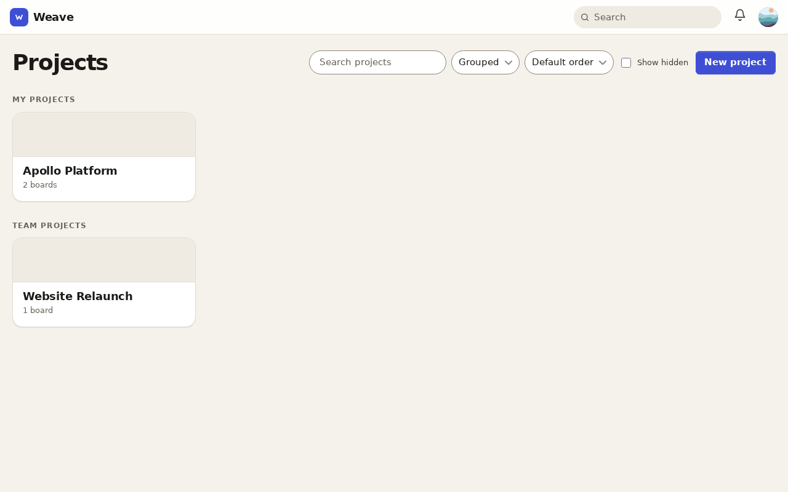
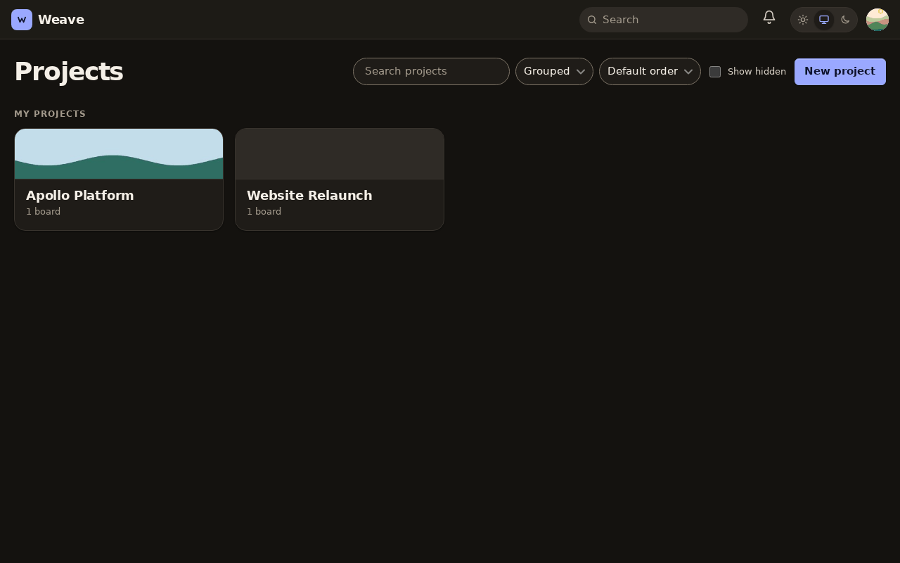

# Weave design system

Tokens and base styles live in `internal/web/static/weave.css`; reusable components in `weave_ui.css`.
Both are loaded by `layout.html`. Domain stylesheets must use the tokens (never hard-coded colours).
Contrast is checked with `python3 scripts/check-contrast.py` (WCAG AA, both themes).

## Principles
- **No gradients, anywhere.** Surfaces are flat solid colours, separated by 1px borders and restrained shadows. The logo mark and favicon are a flat accent-coloured square with a white "W". Planka's named gradient presets remain a stored value for compatibility but render as one flat solid colour (`projects.GradientSolids`). Skeleton loading is an opacity pulse, not a shimmer sweep.
- Minimal but beautiful: generous spacing, a clear type hierarchy, one accent colour.

## Theming
- `<html data-theme="light|dark">` forces a theme; no attribute means follow `prefers-color-scheme`.
- User choice: `localStorage['weave-theme']` = `light | dark | system`, applied by an inline script in `<head>` before first paint.
  The top-bar toggle (sun / auto / moon, `[data-theme-set]`) also saves to the server via `PATCH /api/v1/users/me/preferences` (`theme`: `light|dark|auto`).
- Fonts: system stacks only (`--font-sans`, `--font-display` uses `ui-rounded` where available, `--font-mono`). Nothing is downloaded.

## Tokens
| Group | Tokens |
|---|---|
| Surfaces | `--bg` page, `--surface` cards/panels, `--surface-2` subtle fill, `--surface-3` hover/inset, `--border`, `--border-strong` (inputs, 3:1), `--overlay` modal scrim |
| Text | `--fg`, `--fg-2` secondary, `--muted` (all AA on every surface) |
| Intent | `--accent`, `--accent-hover`, `--accent-soft`, `--accent-fg` (text on accent), `--danger[-soft]`, `--success[-soft]`, `--warning[-soft]`, `--focus-ring` |
| Board | `--list-bg`, `--list-bg-hover`, `--tile-bg`, `--tile-border`, `--tile-shadow`, `--tile-shadow-hover`, `--drop-indicator` |
| Labels | `--label-red orange yellow green teal blue indigo purple pink gray` with text colour `--label-fg` (white in light, near-black in dark) |
| Shape | `--radius-sm` 6, `--radius` 10, `--radius-lg` 16, `--radius-pill`; `--shadow-1/2/3` |
| Type | `--font-sans`, `--font-display`, `--font-mono`; `--text-xs` .75rem, `-sm` .8125, `-md` .9375, `-lg` 1.125, `-xl` 1.5, `-2xl` 2.25 |
| Space | `--space-1..8` = .25 .5 .75 1 1.5 2 3 4.5 rem |
| Motion | `--ease`, `--dur-fast` .12s, `--dur` .22s (all motion collapses under `prefers-reduced-motion`) |
| Misc | `--topbar-h`; legacy alias `--card` = `--surface` |

Planka label/list colour names map onto the label tokens through `.lc-<name>` (and `.cards-color-<name>`): ``.

## Components (weave_ui.css)
- Buttons: `.btn` (also `a.btn`), `.btn-primary`, `.btn-ghost`, `.btn-danger`, sizes `.btn-sm` `.btn-lg`; bare `button`, `button.primary`, `button.danger` are styled too. `.icon-btn` for round icon buttons.
- Inputs: bare `input/select/textarea` are styled; `.field` wraps label + control. Disabled fields render flat on `--surface-2` with `--fg-2` text so read-only values never look editable; prefer plain text over disabled fields for read-only lists.
- The `hidden` attribute always wins (`[hidden]{display:none!important}` in `weave.css`): component `display` rules never show an element a script or template hid.
- `.chip` / `.badge` (+ `-accent -success -warn -danger`), `.label` (+ `-red`...`-gray`), `.kbd`.
- `.avatar` (`-sm`, `-lg`), `.avatar-stack`.
- `.menu` (a `
` with `.menu-panel`, `.menu-item`, `.menu-sep`, `.menu-head`), `.dropdown`.
- `.tabs` (`aria-current` / `.on` marks the active tab).
- `.closed-mark` (partial `closed_mark` in `_closed_mark.html`): the closed-card indicator, a 14px inline SVG round check (circle plus tick, flat 1.6px strokes, no fill) in `--success`, placed before a closed card's title on every surface (tiles, list rows, calendar chips, share page) and inside the card sheet's `.cards-badge-closed` (success-soft badge reading "Closed"). It carries `title="Closed"` and the sr-only text "Closed: ". Do not confuse it with the sprite's `#i-check` (the checklist box). Checked at 3:1 (non-text) on every surface and every filled-tile tint by `check-contrast.py`. A closed tile's title uses `--fg-2`; never fade cards with opacity.
- `closed_mark_ico` (same file): the bare glyph, aria-hidden and untitled, for places that name it themselves: a column whose setting **Close cards that land here** is on shows it in the kanban header (`.boards-col-closes`, `role="img"`, aria-label/title "Closes cards that land here", `--success`, 0.9rem like the watch bell), in the column menu's `menuitemcheckbox` (`--fg-2` off, `--success` on), in the column sheet's "Closes cards" badge (`.cards-badge-closed`) and Properties value, and in the template gallery (`.tg-closes`, `.tg-chip-closes`). The confirm before switching it on a column with cards (`.closes-confirm`: `--surface-2` panel, bold count heading, `--fg-2` body, full-width primary default + secondary, quiet Cancel) is shared by the sheet popover and the column menu. Checked at 3:1 on `--list-bg`, `--list-bg-hover` and every pill-mode column tint.
- **Also-on marker** (`boards_also_btn` in `_boards_view.html`, `.boards-also` in `boards_board.css`): a card on several boards (docs/DESIGN.md "Placements"). A small neutral pill in the tile's meta row (and after the name in the list view): the two-squares glyph (sprite `#i-boards`: a back square drawn as its visible L, a front square, 1.5px strokes, no fill) plus the count of OTHER boards the viewer can see (`Tile.AlsoOn`). Never colour coded: `--fg-2` on `--surface-2` with a `--border` outline; hover/open `--fg` on `--surface-3`; on a filled tile `--surface` with `--border-strong`, like the due chip (all pairs in `check-contrast.py`). It is a `<button>` (`data-also-on`, `aria-haspopup="dialog"`, `aria-expanded`, aria-label/title "Also on N other board(s)", the visible count `aria-hidden`); its `::after` widens the hit area (44px on touch) without growing the tile. It opens `.boards-also-pop` in `#boards-pop` (the quick-edit container, so the board shortcuts already leave its keys alone): heading "Also on N other boards", then one link per board (`.boards-also-item`: board name `--fg` 600, a "home" outline pill, a second line in `--fg-2` with the column and, for another project, the project). Enter/Space open, arrows move, Escape or a click outside close and focus returns to the marker; it never opens the card sheet and is excluded from drag starts. Not shown on the public read-only page. The card sheet repeats the same "board, then column (and project)" lines in its board crumb switcher (`.cm-boardsw`, a `cards-pop`; on phones only the glyph, as the crumbs give way to the watch button) and in the read-only **Boards** property row (`.cm-boards`, home first; the context board bold; on phones a compact chip at the end of the property strip). Phase 5b adds, in the same neutral style: per board an "x" (`.cm-board-x`, `--muted`, hover `--fg` on `--surface-3`; the name ellipsises first), the quiet **Add to board...** button (`.cm-board-add`, `--fg-2`; a pill chip on phones) and a `--muted` hint on a single board. The **picker** (`.cm-place`, `cards_place.js`): a `--surface` panel with `--border-strong` and `--shadow-3` (like the quick edit), header "Add to board" + the card name in `--muted`, a search field, project headings in small caps `--muted`, board rows with a CSS chevron, a columns step with a "default" note and "closes cards" for closing columns, an inline error (`--danger` on `--danger-soft`) and a status line (`--fg-2`); fixed over the page or the sheet, a bottom sheet at <=640px. The **confirmation** (`.cm-confirm`, a modal `<dialog>`: title 650, text `--fg-2`, Cancel ghost + a `.btn-danger` action) replaces the browser's confirm for every `hx-confirm` carrying `data-confirm-title`.
- `.card`, `.panel` surfaces; `.empty-state` (`.empty-art`, heading, text, optional button); `.skeleton` shimmer block.
- `<dialog id="modal">` with `.sheet` padding: full-screen on phones; `#toasts` / `.toast` (`-error`, `-success`).
- Top bar: `.topbar`, `.brand` + `.brand-mark`, `.topbar-search` (an icon link `.topbar-search-link` replaces it at <=900px), `.theme-toggle`. Board pages fill the layout's `topbar-page` slot with `.topbar-crumbs` (breadcrumb `<ol>`; the board name is the page's `h1`; the root crumb hides at <=900px, everything but the board name at <=640px) and `.view-switch` (icon-only segmented group of `<a>`; it shares the `.theme-toggle` look, the active item is keyed on `aria-current="page"` / `aria-pressed`). Phones (<=640px) hide the top-bar theme toggle and view switcher: the theme switch is repeated in the account menu (`.menu-theme`) and the views become a `details.boards-dd.view-pick` popover in the board's filter row.

### Help tip
A small "?" in a circle that explains a control or rule in one sentence instead of permanent hint text that eats space:
`{{template "help_tip" dict "ID" "unique-id" "Text" "One short sentence."}}` (`templates/_help_tip.html`, CSS `.help-tip` in
`weave_ui.css`, behaviour in `weave.js`). It is a real `<button>` (keyboard focusable, `aria-describedby` the tip text); hover,
focus or a tap shows the tip, Escape or a click elsewhere hides it. The tip is fixed-positioned and clamped to the viewport, so no
scroll container or dialog can clip it. Use it for explanations of one sentence; longer help belongs in the docs. IDs must be
unique per page. Colours are tokens only (`--fg-2`, `--border-strong`, `--accent`, `--surface`, `--shadow-2`).

## Colour surfaces (boards_colors.css)
Board colour, column colour and filled cards are flat tints made with `color-mix(in oklab, <colour> N%, <surface>)`; the full colour appears only as 3-4px bars and swatches. Tint strengths are `--tint-board` (8% light, 6% dark), `--tint-list` (6%, pill mode only: fill-mode columns are neutral) and `--tint-fill` (cards, 20% / 24%). Inside coloured columns and filled tiles `--muted` is remapped to `--fg-2` to stay AA. The list "..." menu, filter dropdowns, the card quick-edit and the card-shortcut pickers (labels, due date, location) are fixed-position popovers placed by `boards_popover.js` (flip above/left, capped max-height, bottom sheet at <=640px); the list menu and quick edit are portaled to `<body>` (`#popover-root`) while open.

## Accessibility
Visible `:focus-visible` rings on everything, AA text contrast in both themes, 3:1 input borders, reduced-motion support, responsive down to ~360px.

 
