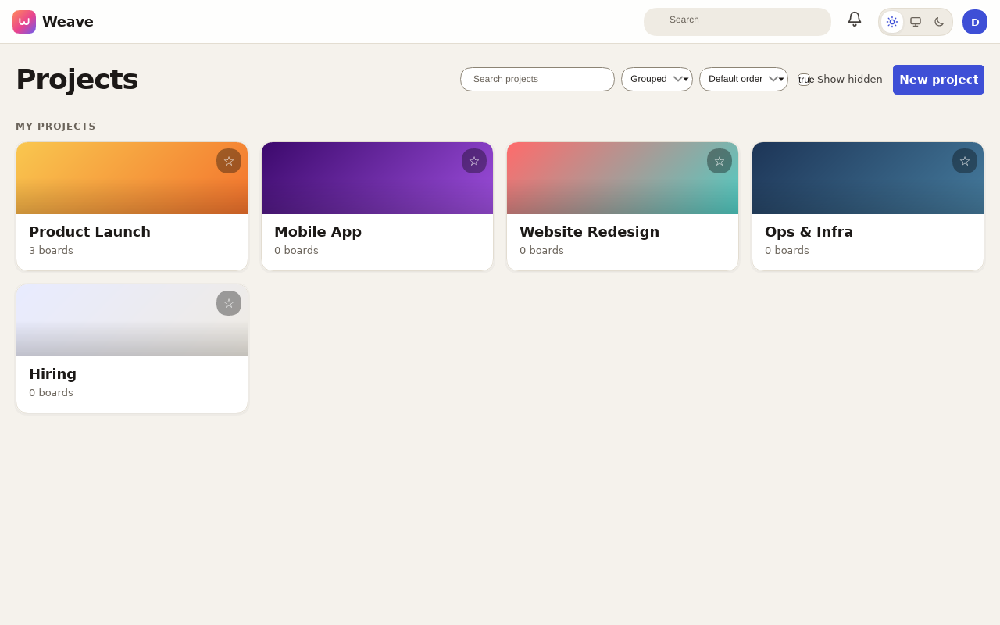
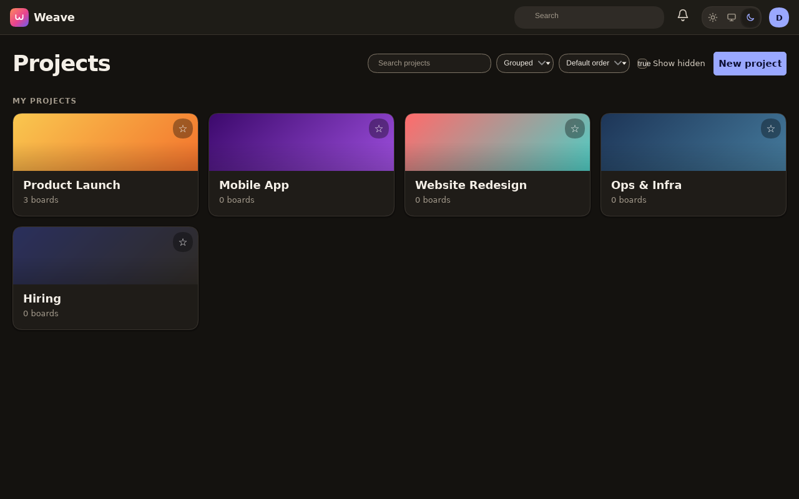

# Weave design system

Tokens and base styles live in `internal/web/static/weave.css`; reusable components in `weave_ui.css`.
Both are loaded by `layout.html`. Domain stylesheets must use the tokens (never hard-coded colours).
Contrast is checked with `python3 scripts/check-contrast.py` (WCAG AA, both themes).

## Principles
- **No gradients, anywhere.** Surfaces are flat solid colours, separated by 1px borders and restrained shadows. The logo mark and favicon are a flat accent-coloured square with a white "W". Planka's named gradient presets remain a stored value for compatibility but render as one flat solid colour (`projects.GradientSolids`). Skeleton loading is an opacity pulse, not a shimmer sweep.
- Minimal but beautiful: generous spacing, a clear type hierarchy, one accent colour.

## Theming
- `<html data-theme="light|dark">` forces a theme; no attribute means follow `prefers-color-scheme`.
- User choice: `localStorage['weave-theme']` = `light | dark | system`, applied by an inline script in `<head>` before first paint.
  The top-bar toggle (sun / auto / moon, `[data-theme-set]`) also saves to the server via `PATCH /api/v1/users/me/preferences` (`theme`: `light|dark|auto`).
- Fonts: system stacks only (`--font-sans`, `--font-display` uses `ui-rounded` where available, `--font-mono`). Nothing is downloaded.

## Tokens
| Group | Tokens |
|---|---|
| Surfaces | `--bg` page, `--surface` cards/panels, `--surface-2` subtle fill, `--surface-3` hover/inset, `--border`, `--border-strong` (inputs, 3:1), `--overlay` modal scrim |
| Text | `--fg`, `--fg-2` secondary, `--muted` (all AA on every surface) |
| Intent | `--accent`, `--accent-hover`, `--accent-soft`, `--accent-fg` (text on accent), `--danger[-soft]`, `--success[-soft]`, `--warning[-soft]`, `--focus-ring` |
| Board | `--list-bg`, `--list-bg-hover`, `--tile-bg`, `--tile-border`, `--tile-shadow`, `--tile-shadow-hover`, `--drop-indicator` |
| Labels | `--label-red orange yellow green teal blue indigo purple pink gray` with text colour `--label-fg` (white in light, near-black in dark) |
| Shape | `--radius-sm` 6, `--radius` 10, `--radius-lg` 16, `--radius-pill`; `--shadow-1/2/3` |
| Type | `--font-sans`, `--font-display`, `--font-mono`; `--text-xs` .75rem, `-sm` .8125, `-md` .9375, `-lg` 1.125, `-xl` 1.5, `-2xl` 2.25 |
| Space | `--space-1..8` = .25 .5 .75 1 1.5 2 3 4.5 rem |
| Motion | `--ease`, `--dur-fast` .12s, `--dur` .22s (all motion collapses under `prefers-reduced-motion`) |
| Misc | `--topbar-h`; legacy alias `--card` = `--surface` |

Planka label/list colour names map onto the label tokens through `.lc-<name>` (and `.cards-color-<name>`): ``.

## Components (weave_ui.css)
- Buttons: `.btn` (also `a.btn`), `.btn-primary`, `.btn-ghost`, `.btn-danger`, sizes `.btn-sm` `.btn-lg`; bare `button`, `button.primary`, `button.danger` are styled too. `.icon-btn` for round icon buttons.
- Inputs: bare `input/select/textarea` are styled; `.field` wraps label + control.
- `.chip` / `.badge` (+ `-accent -success -warn -danger`), `.label` (+ `-red`...`-gray`), `.kbd`.
- `.avatar` (`-sm`, `-lg`), `.avatar-stack`.
- `.menu` (a `
` with `.menu-panel`, `.menu-item`, `.menu-sep`, `.menu-head`), `.dropdown`.
- `.tabs` (`aria-current` / `.on` marks the active tab).
- `.card`, `.panel` surfaces; `.empty-state` (`.empty-art`, heading, text, optional button); `.skeleton` shimmer block.
- `<dialog id="modal">` with `.sheet` padding: full-screen on phones; `#toasts` / `.toast` (`-error`, `-success`).
- Top bar: `.topbar`, `.brand` + `.brand-mark`, `.topbar-search`, `.theme-toggle`.

## Colour surfaces (boards_colors.css)
Board colour, column colour and filled cards are flat tints made with `color-mix(in oklab, <colour> N%, <surface>)`; the full colour appears only as 3-4px bars and swatches. Tint strengths are `--tint-board` (8% light, 6% dark), `--tint-list` (6%, pill mode only: fill-mode columns are neutral) and `--tint-fill` (cards, 20% / 24%). Inside coloured columns and filled tiles `--muted` is remapped to `--fg-2` to stay AA. The list "..." menu, filter dropdowns and the card quick-edit are fixed-position popovers placed by `boards_popover.js` (flip above/left, capped max-height, bottom sheet at <=640px); the list menu and quick edit are portaled to `<body>` (`#popover-root`) while open.

## Accessibility
Visible `:focus-visible` rings on everything, AA text contrast in both themes, 3:1 input borders, reduced-motion support, responsive down to ~360px.

 
